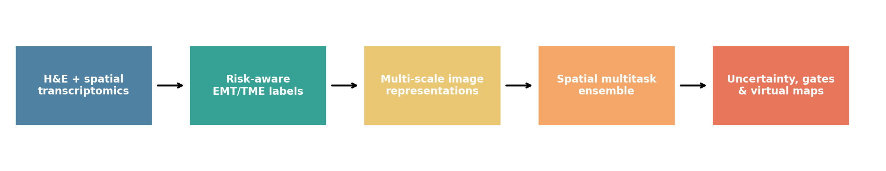
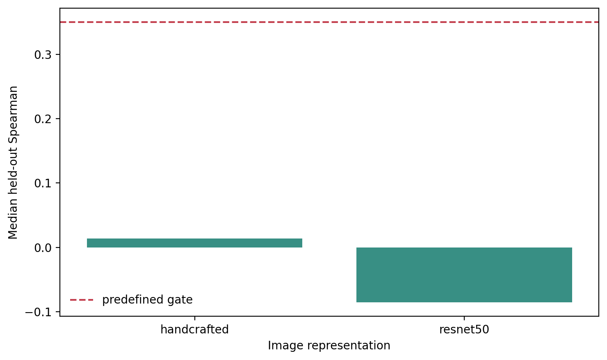
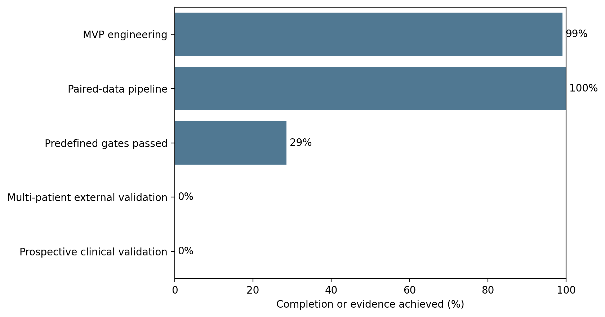

# EMT-ViSTA Implementation Report

## Executive Status

The executable EMT-ViSTA MVP is implemented across 5 public spatial datasets and 16862 aligned spots. Internal engineering completion is 99.0%. This percentage measures software/readiness work, not scientific or clinical validation.

Lung squamous and colorectal examples are held out at dataset level. They are technical external tests, not independent clinical cohorts.

## Implemented System

- Confidence-tiered epithelial, mesenchymal, partial-EMT, CAF, TAM, hypoxia, ECM, and stromal-risk labels.
- Multi-scale H&E extraction with handcrafted, ResNet50, Phikon-v2, and H-Optimus-0 adapters.
- Malignant-gated partial EMT and explicit stromal-inflation risk.
- Image-only and graph-refined bootstrap multitask models.
- Predictive uncertainty, abstention, calibration, stroma false-positive, and go/no-go reports.
- H&E overlays, coordinate maps, GeoJSON hotspots, model metadata, and reproducible CLIs.

## Backend Benchmark

| backend     |   test_spots |   median_test_spearman |   best_test_spearman | best_program      |   gates_passed |   gates_total |   partial_emt_auprc_above_prevalence |   stroma_false_positive_rate |   calibration_error |
|:------------|-------------:|-----------------------:|---------------------:|:------------------|---------------:|--------------:|-------------------------------------:|-----------------------------:|--------------------:|
| handcrafted |         1024 |                  0.014 |                0.310 | epithelial        |              2 |             7 |                                0.103 |                        0.000 |               0.113 |
| resnet50    |          256 |                 -0.086 |               -0.032 | partial_emt_score |              2 |             7 |                                0.075 |                        0.015 |               0.144 |

## Readiness Is Multi-Dimensional

The engineering percentage is not a biological success score. The validation chart reports the dimensions separately; failed predefined gates remain failed.

## Interpretation

A failed gate is a valid result: it prevents morphology associations from being overstated as molecular measurement. Handcrafted and ImageNet controls establish whether apparent performance comes from color, texture, or general image features. Pathology-foundation performance must be evaluated at adequate sample size before biological conclusions are made.

## Remaining Scientific Work

- Scale pathology-foundation extraction on a CUDA GPU.
- Add multi-patient HEST/GEO/HTAN cohorts with disease-matched deconvolution.
- Obtain calibrated pathologist tumor, invasive-edge, stroma, necrosis, and immune-region labels.
- Validate against an untouched institution and technology.
- Perform prospective assay-triage evaluation before any clinical-use claim.

## Conclusion

EMT-ViSTA is an operational research pipeline. Its current outputs are virtual-stain hypotheses with explicit uncertainty and contamination controls. Publication claims depend on the predefined external-validation gates, not on completion of the software alone.
