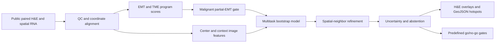

# EMT-ViSTA Student Project Report

## The Project in One Sentence

EMT-ViSTA tests whether routine H&E morphology can predict spatial maps of
epithelial, mesenchymal, partial-EMT, CAF, TAM, hypoxia, ECM-remodeling, and
stromal-contamination signals learned from paired spatial transcriptomics.

## Why This Problem Matters

Spatial transcriptomics is informative but expensive and is not routinely
available for every pathology slide. H&E is inexpensive and ubiquitous. A
well-validated virtual stain could nominate tissue regions for molecular
profiling, invasive-front review, or mechanistic experiments. It must not be
presented as a replacement for pathology or molecular assays.

Recent work treats EMT as a spectrum of dynamic epithelial-mesenchymal
plasticity rather than a binary switch. Partial states can co-express
epithelial and mesenchymal programs, while fibroblast-rich spots can falsely
look mesenchymal. EMT-ViSTA therefore predicts both the signal and a stromal
inflation risk.

## Executed Workflow

## Data Used in the First Real Run

Five aligned public 10x cancer datasets contributed 16,862 molecularly scored
spots. Breast and prostate were used for training, ovarian for validation, and
lung squamous carcinoma plus intestinal/colorectal cancer were held out as
dataset-level technical tests. These are not independent multi-patient
clinical cohorts.

The CPU benchmark used bounded samples to keep the run reproducible on a
workstation:

- Handcrafted multi-scale color, texture, and tissue features: 2,560 spots.
- ImageNet ResNet50 embeddings: 640 spots.
- Phikon-v2 adapter check: 10 spots, proving the pathology-foundation backend
  and cached weights work; this is not a valid performance benchmark.
- H-Optimus-0 adapter: implemented, with metadata access verified; its weights
  remain subject to the model host's access workflow.

## Label Design

Primary continuous targets are epithelial, mesenchymal, partial-EMT, CAF,
TAM-SPP1, hypoxia, ECM remodeling, and stromal contamination risk. A candidate
partial-EMT label requires both epithelial and mesenchymal activity. A
malignant-gated partial-EMT probability is reduced when epithelial evidence is
weak or stromal risk is high. Confidence tiers record whether a spot is suitable
for supervised training, weak supervision, or abstention.

This design directly addresses a common error: calling a fibroblast-rich spot
"EMT-high" without demonstrating malignant epithelial involvement.

## Model and Technical Details

The v1 model is deliberately interpretable and computationally modest:

1. Extract center and context image representations.
2. Add the mean representation of spatial nearest neighbors.
3. Fit bootstrapped PCA plus ridge multitask regressors.
4. Use ensemble spread as epistemic uncertainty.
5. Calibrate and gate partial-EMT predictions.
6. Abstain where uncertainty or contamination risk is excessive.

This provides a strong test harness before investing in a large GPU graph
Transformer. It also reveals whether a complex model would be learning a real
cross-cohort signal or merely fitting slide-specific stain patterns.

## Preliminary Findings

The main finding is negative but useful. On held-out lung and colorectal spots,
neither the handcrafted nor generic ResNet50 representation met the predefined
molecular accuracy criteria.

| Backend | Test spots | Median test Spearman | Best program | Best Spearman | Gates passed |
|---|---:|---:|---|---:|---:|
| Handcrafted | 1,024 | 0.014 | Epithelial | 0.310 | 2/7 |
| ResNet50 | 256 | -0.086 | Partial-EMT score | -0.032 | 2/7 |

The pure-stroma false-positive criterion passed for both controls. The model did
not pass overall partial-EMT discrimination, calibration, correlation, or
uncertainty-improvement gates. This means the generated maps are research
hypotheses, not measured molecular maps.

## What We Can and Cannot Conclude

We can conclude that the complete data, modeling, uncertainty, evaluation, and
map-export pipeline works on real paired slides. We can also conclude that
simple morphology features and generic ImageNet features do not generalize
adequately from the selected training cancers to the held-out lung and
colorectal slides at the sampled scale.

We cannot conclude that H&E reliably measures EMT, that predicted hotspots are
invasive fronts, or that the model is ready for clinical decisions. Pathology
foundation models, patient-level cohorts, pathologist regions, and external
validation remain necessary scientific experiments.

## Best Next Experiments

1. Run Phikon-v2 or H-Optimus on all spots with CUDA and compare against the
   exact same split and gates.
2. Add multiple patients per cancer and use leave-patient-out evaluation.
3. Add tumor/stroma/necrosis/invasive-front annotations from two pathologists.
4. Use matched scRNA-seq deconvolution to refine malignant and stromal labels.
5. Test stain normalization and domain-adversarial training as controlled
   ablations, not as hidden preprocessing.
6. Validate lung and CRC models on an untouched institution and platform.

## Key Literature

- Dong A, Blanpain C. Identification, functional insights and therapeutic
  targeting of EMT tumour states. Nature Reviews Cancer (2026):
  https://www.nature.com/articles/s41568-025-00873-0
- Thompson EW et al. EMT and cancer: what clinicians should know. Nature
  Reviews Clinical Oncology (2025):
  https://www.nature.com/articles/s41571-025-01058-2
- Jaume G et al. HEST-1k: A Dataset for Spatial Transcriptomics and Histology
  Image Analysis. NeurIPS Datasets and Benchmarks (2024):
  https://proceedings.neurips.cc/paper_files/paper/2024/file/60a899cc31f763be0bde781a75e04458-Paper-Datasets_and_Benchmarks_Track.pdf
- Filiot A et al. Phikon-v2, a large and public feature extractor for biomarker
  prediction (2024): https://arxiv.org/abs/2409.09173
- STPath: a generative foundation model for integrating spatial transcriptomics
  and whole-slide images. npj Digital Medicine (2025):
  https://www.nature.com/articles/s41746-025-02020-3

## Reproducibility

Run `scripts/run_emt_vista_pipeline.py` with
`configs/emt_virtual_spatial_staining.yml`. Large public data and generated
artifacts remain under `data/` and are excluded from Git. The repository stores
configuration, scripts, tests, compact reports, and figures.
