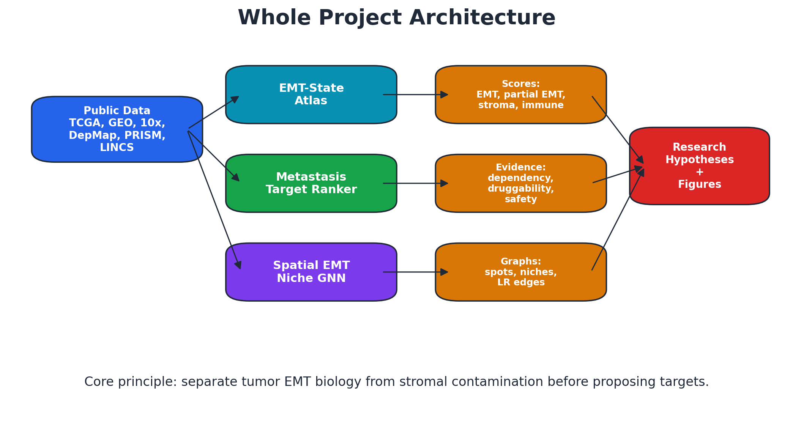
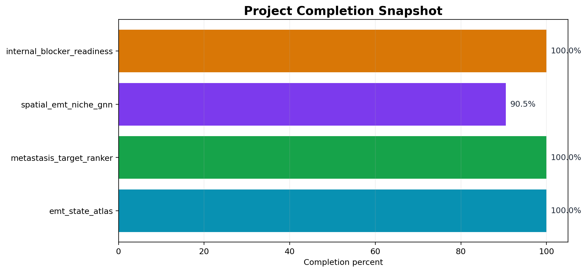
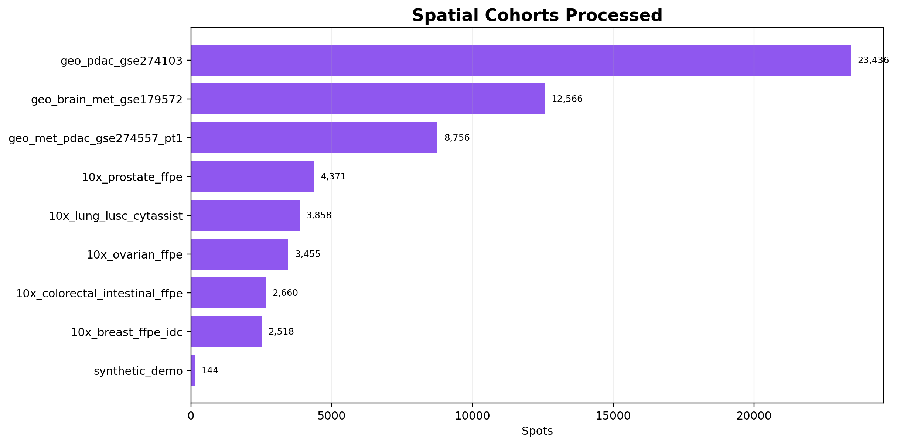
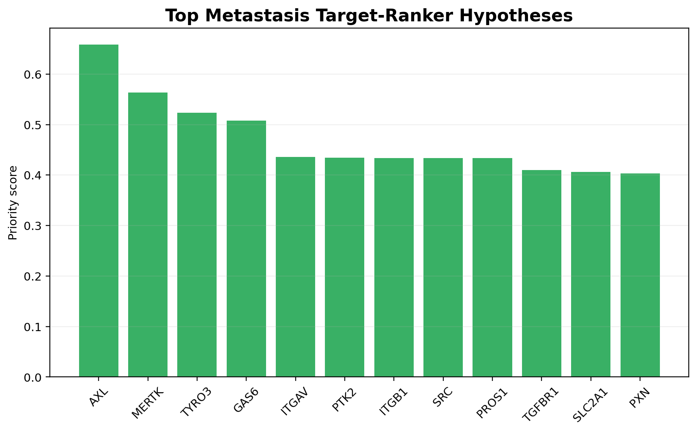
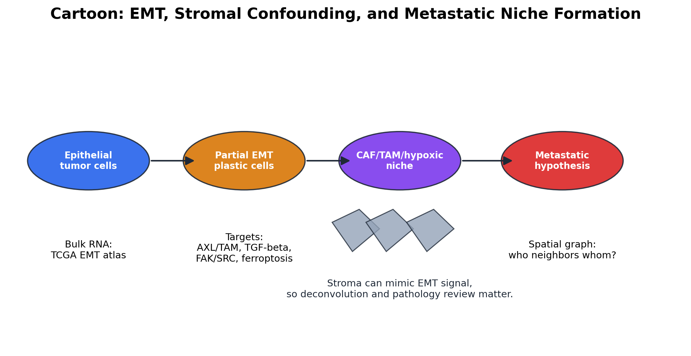

# Project Interview Guide: Concepts, Methods, Tools, Findings

## 1. One-Minute Project Pitch

I built a public-data AI pipeline for studying EMT, metastasis, and therapeutic target susceptibility. The project has three connected parts: an EMT-state atlas across TCGA, a metastasis target ranker integrating druggability and dependency evidence, and a spatial EMT niche graph pipeline that models tumor-stroma-immune neighborhoods in spatial transcriptomics. The key idea is to distinguish true malignant EMT from stromal contamination and then use that context to propose testable target hypotheses.

## 2. High-Level Diagram

## 3. Concept Questions

### What is EMT and why is it important in cancer?
EMT is a biological plasticity program where epithelial cells gain mesenchymal-like traits such as motility, invasion, stress tolerance, and therapy resistance. In cancer, EMT-like states are linked to metastasis and treatment escape, but EMT is not always a simple binary switch.

### Why did you focus on partial EMT?
Many tumors show hybrid states rather than fully epithelial or fully mesenchymal states. Partial EMT can preserve proliferation and cell-cell adhesion while gaining invasive capacity, so it may be especially relevant for metastatic niches.

### Why is stromal correction important?
Spatial and bulk samples can contain CAFs, fibroblasts, immune cells, and tumor cells together. Mesenchymal genes may come from stromal cells rather than cancer cells. Without stromal correction, a model might incorrectly call CAF-rich tissue malignant EMT.

## 4. Methodology Questions

### What are the main pipelines?
1. EMT-state-atlas scores TCGA/Xena samples for EMT, partial EMT, stromal risk, immune context, hypoxia, and related signatures.
2. Metastasis-target-ranker combines evidence such as EMT specificity, metastasis association, dependency, druggability, compound availability, safety risk, and literature support.
3. Spatial-EMT-niche-GNN scores Visium/GEO cohorts, builds spatial graphs, trains interpretable graph-aware baselines, and prepares deconvolution/pathologist review.

### How did you build spatial graphs?
Nodes are spatial spots or inferred compartments. Edges include k-nearest spatial neighbors, physical radius neighbors, ligand-receptor edges, hypoxia gradients, ECM gradients, and histology-similarity edges when H&E features are available.

### What is the model trying to predict?
The first model predicts weak EMT-niche labels derived from EMT, partial EMT, CAF/TAM, hypoxia, ECM, and stromal-risk scores. This is intentionally hypothesis-generating; final validation needs expert pathology and stronger labels.

### How did you handle deconvolution?
The project includes marker-proxy deconvolution, NNLS reference deconvolution, and prepared inputs for Tangram, cell2location, and RCTD/spacexr. A real GSE154778 PDAC scRNA-derived reference is already built.

## 5. Technical Questions

### Which languages and tools are used?
Python, pandas, numpy, scipy, matplotlib, h5py/AnnData, scanpy, PyTorch CPU, Tangram, cell2location, R 4.6 with spacexr/RCTD, HuggingFace Hub, Synapse, Gen3, and HTAN CLI.

### Why use simple interpretable baselines before deep learning?
Because biology and data quality are the hard part. Interpretable scoring and graph baselines reveal whether labels are plausible before using complex GNNs that might hide confounding.

### What makes the project reproducible?
Large public datasets stay local under `data/raw/`; GitHub stores scripts, manifests, documentation, small outputs, test data, and reports. Every blocker now has a status manifest or script.

## 6. Findings You Can Mention

- TCGA cancer types with high mean EMT signals include sarcoma, GBM, melanoma, and others in the current Xena summary.
- Spatial cohorts repeatedly show that EMT-niche labels require stromal interpretation.
- GSE274557 metastatic PDAC was scaled to all 55 non-PDX samples, with patient-batched graph summaries across 13 patients.
- Peritoneal metastatic PDAC shows higher EMT-niche fraction than liver metastasis in the current scoring summary.
- The top target hypotheses include:

| Target | Family | Why it is interesting |
| --- | --- | --- |
| AXL | AXL_TAM | Multi-evidence priority score 0.658. |
| MERTK | AXL_TAM | Multi-evidence priority score 0.564. |
| TYRO3 | AXL_TAM | Multi-evidence priority score 0.523. |
| GAS6 | AXL_TAM | Multi-evidence priority score 0.508. |
| ITGAV | FAK_SRC_integrin | Multi-evidence priority score 0.436. |

## 7. Advantages Of The Approach

- Uses public data, so others can reproduce or challenge it.
- Separates EMT from stromal contamination instead of ignoring confounding.
- Combines bulk, single-cell reference, spatial transcriptomics, target evidence, and pathology review planning.
- Produces interpretable evidence cards and review queues rather than only black-box predictions.

## 8. Limitations To State Honestly

- Current labels are weak labels, not final pathologist-validated labels.
- Visium spots are mixtures of multiple cells.
- Some resources are gated by licenses or credentials.
- Target rankings are research hypotheses, not clinical recommendations.
- Full cell2location/Tangram/RCTD publication runs need careful cell-level scRNA references and compute.

## 9. Likely Interview Questions And Answers

### Q: What is the novelty?
A: The novelty is the integrated, contamination-aware workflow: EMT-state scoring, metastasis target ranking, spatial niche graph modeling, deconvolution, and pathology review are connected into one reproducible public-data framework.

### Q: Why graph modeling?
A: Metastasis and EMT are niche-dependent. A spot's biology depends not only on its own expression but also on neighboring CAFs, TAMs, hypoxia, ECM, and ligand-receptor interactions.

### Q: Why not directly claim a biomarker?
A: Because the current labels are weak and public datasets vary in quality. The scientifically responsible output is a ranked set of hypotheses and validation-ready workflows.

### Q: How would you validate experimentally?
A: First use pathologist review and deconvolution; then validate targets in EMT-high and EMT-low cell models using CRISPR or drug perturbation; finally test spatial localization with multiplex imaging or spatial transcriptomics.

### Q: What would you improve next?
A: Add expert pathology labels, run full cell-level deconvolution, add HTAN validation, run foundation pathology embeddings, and build stronger leave-cohort-out GNN validation.

## 10. Visuals To Explain During Interview

