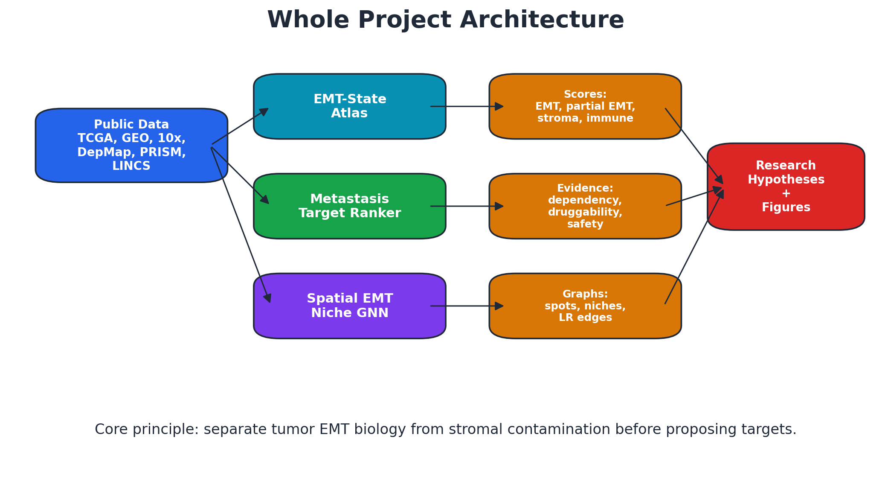
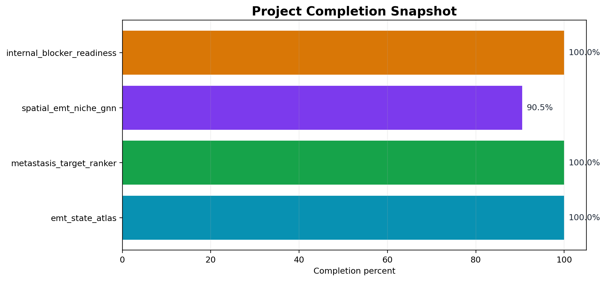
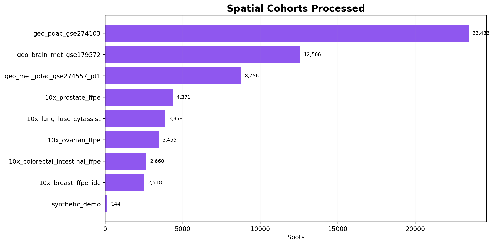
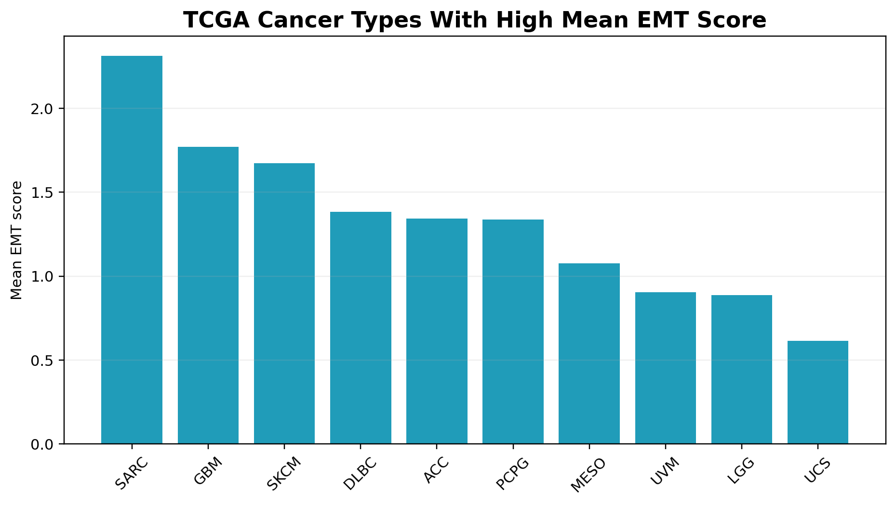
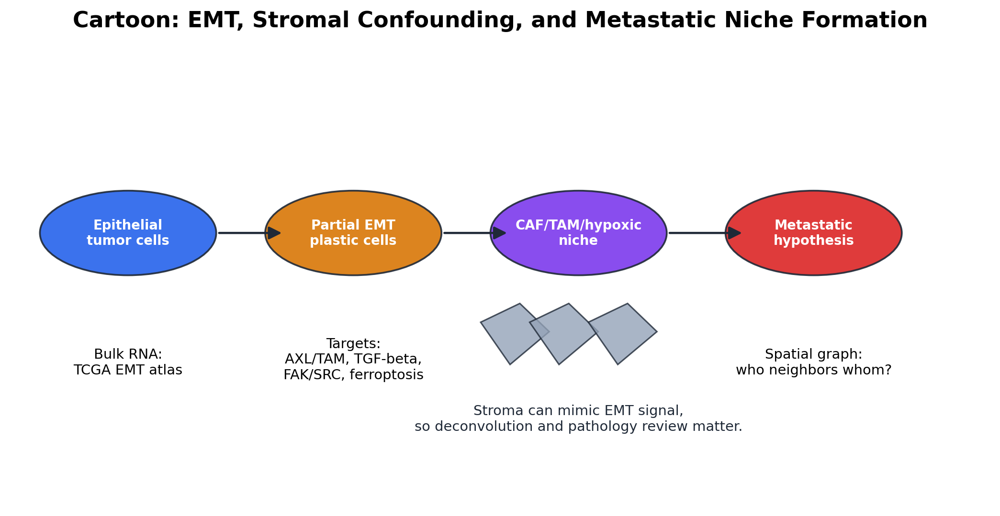
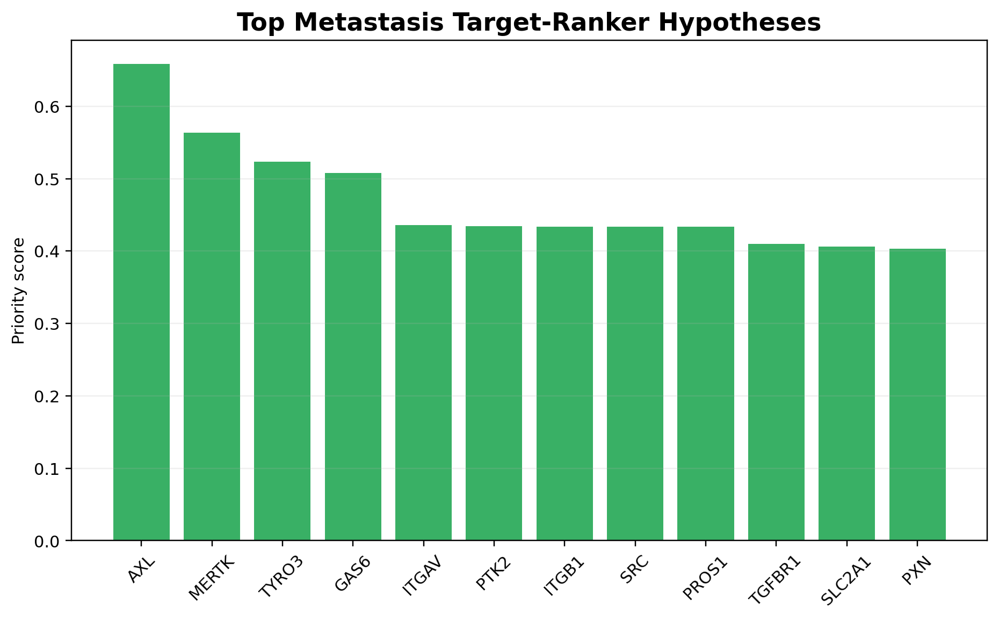

# AI in Cancer Drug Discovery: Student-Friendly Project Report

## 1. Big Picture

This project asks a practical research question: can public data and AI/ML help us understand epithelial-to-mesenchymal transition (EMT), metastasis, and target susceptibility in cancer?

The answer from the current project is: yes, as a hypothesis-generation system. The pipeline does not make clinical recommendations. It builds interpretable scores, graphs, target rankings, and validation queues that students and scientists can inspect.

## 2. The Three Main Project Pillars

| Pillar | What it does | Main output |
| --- | --- | --- |
| EMT-state-atlas | Scores EMT, partial EMT, stromal contamination, immune context, and survival-ready outputs across TCGA/Xena. | `emt_scores.tsv`, `cancer_type_summary.tsv`, survival associations |
| Metastasis-target-ranker | Integrates target evidence from dependency, druggability, compounds, safety risk, and literature. | ranked targets and evidence cards |
| Spatial-EMT-niche-GNN | Scores spatial transcriptomics, builds graphs, interprets niches, prepares deconvolution and pathology review. | spatial scores, graph summaries, model metrics, review queues |

## 3. Current Completion

The two original core projects are complete in the tracker, while the spatial project is 90.5% complete by weighted workflow progress. The final blocker audit reports 100.0% internal engineering readiness for known blockers.

## 4. Data Used

The project uses public-data-first design. Large files stay local, while GitHub stores scripts, manifests, documentation, and compact outputs.

- TCGA/UCSC Xena for bulk cancer EMT-state analysis.
- 10x Genomics public Visium examples for breast, lung, prostate, ovarian, and colorectal cancer.
- GEO pancreatic cancer and brain metastasis spatial cohorts.
- DepMap/PRISM/LINCS/Open Targets/DGIdb/ChEMBL-style evidence for target ranking.
- GSE154778 scRNA-derived reference for first real deconvolution baseline.

## 5. How EMT Is Scored

The EMT score compares epithelial and mesenchymal transcriptional programs. A partial EMT score tries to identify mixed/plastic states where epithelial and mesenchymal signals coexist. This matters because metastasis often involves cell plasticity rather than a simple binary switch.

Important warning: high EMT signal in a tissue spot can come from malignant tumor cells, stromal fibroblasts, CAFs, or mixed spots. That is why the project also scores stromal contamination, CAF/TAM niche, immune context, hypoxia, ECM remodeling, and deconvolution proxies.

## 6. What the Spatial Project Adds

Bulk RNA tells us what genes are expressed, but spatial transcriptomics asks where those programs occur. The spatial project builds graphs where each spot is a node and edges represent physical neighbors, ligand-receptor links, hypoxia gradients, ECM gradients, or histology similarity.

This lets us ask questions like:

- Are EMT-high spots near CAF-rich or TAM-rich regions?
- Are partial EMT regions near invasive-edge-like ECM gradients?
- Are hypoxic niches linked to angiogenesis and ferroptosis windows?
- Which signals are likely tumor-cell EMT versus stromal inflation?

## 7. Target-Ranker Findings

The target ranker prioritizes hypotheses, not drugs for patients. Strong early target families include AXL/TAM signaling, TGF-beta/SMAD, FAK/SRC/integrins, ferroptosis-related genes, CAF/TAM crosstalk, hypoxia metabolism, chromatin regulators, and RNA/P-body regulators.

| Top target | Family | Priority score |
| --- | --- | ---: |
| AXL | AXL_TAM | 0.658 |
| MERTK | AXL_TAM | 0.564 |
| TYRO3 | AXL_TAM | 0.523 |
| GAS6 | AXL_TAM | 0.508 |
| ITGAV | FAK_SRC_integrin | 0.436 |
| PTK2 | FAK_SRC_integrin | 0.435 |
| ITGB1 | FAK_SRC_integrin | 0.434 |
| SRC | FAK_SRC_integrin | 0.434 |

## 8. Main Findings So Far

- EMT and stromal signals often overlap, so stromal correction is essential.
- Partial EMT and CAF/TAM/hypoxic niche signals dominate many first spatial runs.
- Peritoneal metastatic PDAC in GSE274557 shows a higher EMT-niche fraction than liver metastasis in the current scoring summary.
- Real scRNA reference deconvolution is now available for the PDAC pilot and suggests different tumor/stromal/immune mixtures across primary, liver, and peritoneal metastatic samples.
- AXL/TAM family members rank strongly because they combine EMT/metastasis relevance, druggability, compound availability, and literature support.

## 9. What Is Still External

The code side is ready, but some scientific gates cannot be faked:

- HEST/UNI/CONCH downloads require accepted HuggingFace terms and token-based access.
- HTAN assay downloads require selected file IDs and Synapse/Gen3/HTAN credentials.
- Pathology validation requires real expert review of the generated queue.

## 10. How a Student Can Start

1. Read `docs/methods/04_how_to_read_emt_scores.md`.
2. Run toy data tests with `python -m pytest`.
3. Inspect `data/processed/tcga_xena_v1/cancer_type_summary.tsv`.
4. Inspect `data/processed/target_ranker_real_evidence_v1/target_ranking.tsv`.
5. Inspect spatial outputs in `data/processed/spatial_emt_niche_gnn_comparison/`.
6. Use this report to explain the biological logic before going into code.

## 11. Glossary

| Term | Meaning |
| --- | --- |
| EMT | A plasticity program where epithelial cancer cells gain mesenchymal-like traits. |
| Partial EMT | A mixed state with both epithelial and mesenchymal features. |
| CAF | Cancer-associated fibroblast, a stromal cell type that can mimic or support EMT programs. |
| TAM | Tumor-associated macrophage. |
| Deconvolution | Estimating which cell types contribute to a bulk or spatial transcriptomic signal. |
| Graph neural network | A model that learns from nodes and their relationships, useful for spatial neighborhoods. |
| Weak label | A useful but imperfect label derived from rules or proxy scores rather than direct expert annotation. |
